# 机器文摘 第 194 期
### 一个星号捅穿了 sshd

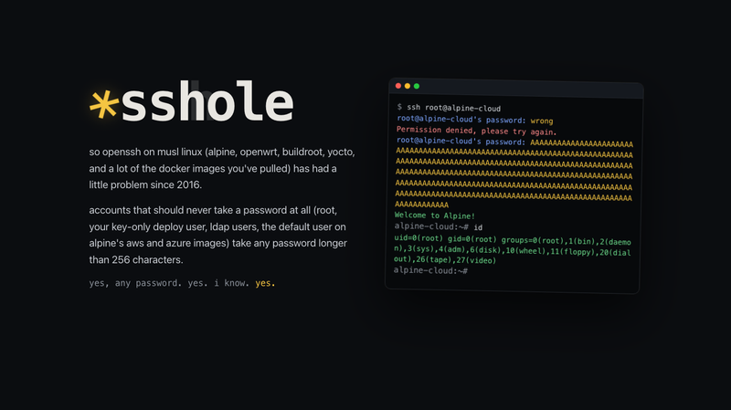

[OpenSSH 10.6p2](https://www.openssh.org/releasenotes.html#10.6p2)，2026-11-05 发布，发布说明里写着 "contains a critical security workaround"，而它修的漏洞，本质上是一个字符的误会。漏洞的完整分析在 [sshhole.com](https://sshhole.com)（ssh + hole，拼出来正好是那个脏字的谐音，域名本身就是个玩笑），发布时甚至还没有分配 CVE 编号。

事情要从 musl libc 的两笔提交说起。2012 年 8 月，musl 把 `crypt()` 失败时的返回值从 `NULL` 改成了一个不可匹配的哈希串——`return (setting[0]=='*') ? "x" : "*";`，理由是"总是返回一个不可匹配的哈希比报错更友好"。二十天后，为了给 sha512crypt 挡住 DoS 攻击，musl 加了 `KEY_MAX 256` 上限：密钥超过 256 字节直接失败，失败就返回上面那个 `"*"`。

问题出在 `/etc/shadow` 的语义上：密码字段为 `"*"` 表示"这个账号没有密码"。这类账号（通常只允许密钥登录）本应永远匹配失败。但 sshd 在校验时做的是字符串比较，而 musl 恰好把 `"*"` 返回给了它——`"*" == "*"`，认证通过。

所以攻击长这样：任何 257 到 1024 字节的密码，对着一个 `"*"` 账号，一次连接、一次尝试、必然成功。Alpine 从 3.16 起把 root 的 shadow 字段从 `!` 改成了 `*`（因为无 PAM 时 `!` 会把 SSH 密钥一起废掉），而官方 AWS/Azure 镜像里的 `alpine` 用户既是 `*` 又带免密 `doas`——等于直接拿 root。

有意思的地方在于为什么能藏这么多年。glibc/libxcrypt 走的是 `"*0"`，差一个字符；主流发行版都过 PAM，PAM 对 `*` 直接短路，根本不调 crypt；全新机器上没有 `*` 账号时不触发；触发还需要一个 `$6$` 哈希的账号当 salt 捐献者（那是 2016 年修时间侧信道时加的代码）。2013 年 Debian 有个 bug report 曾请求 glibc 照抄 musl 的 `"*"`，六年后 Debian 转用 libxcrypt 用 `"*0"` 顺手关掉了这个 bug。2024 年 12 月 musl 邮件列表还在讨论 busybox `passwd` 在 257 字符密码上崩溃——同一个 `"*"`，同一个 256 上限，没人想到去查 sshd。

发现者是 Özgün Kültekin，他构造了 12 种 sshd 构建组合（glibc/musl × PAM/无 PAM × 有/无 shadow），跑了约 17,600 次异常登录，只有 "musl · no pam" 那一组对不该放行的登录说了 yes。时间上有个讽刺：2026-10-30 OpenSSH 的一次安全审查刚修了 `pick_salt()`，bug 就在它下面四行。

发布说明里还有一段罕见的话值得单独读：OpenSSH 团队说收到大量 AI 生成的漏洞报告，很多在真实威胁模型下没有影响，但**同一个 bug 常被不同研究者独立发现**，说明不报漏洞的攻击者同样能找到——所以他们决定放弃攒版本，改为更频繁地发版。10.6p2 就是这个政策的第一个产物，一个只含一处 workaround 和几个 bugfix 的点版本。修起来很简单：升级并重启 sshd，或者 `PasswordAuthentication no`。

### 为了改个时间越狱车机

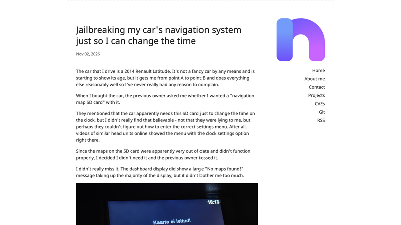

[Renault / TomTom Carminat 逆向](https://blog.nns.ee/2026/11/02/renault-hack/)，HN 951 分。作者住爱沙尼亚，10 月底从夏令时切回冬令时，车上的钟差了一小时——而设置菜单里根本没有"改时间"这一项。

车主早就说过："这车改时间需要那张导航 SD 卡。"作者当时不信，花一小时把所有菜单和按键组合试了一遍，发现仪表台上有两个 Settings 键，一个只能改蓝牙，另一个一按就弹 "No maps detected!"。拆固件后才明白荒谬到什么程度：**菜单结构本身不在车机里**。指向 Settings applet 的菜单定义是从 SD 卡读取的，没插卡，车机根本不知道"如何进入设置"。而且卡必须是被 DRM 认可的卡——校验烧在卡里的 CID，文件签名也基于该 CID 生成，所以把文件 dd 到空白卡上没用。正版卡网上卖 60 欧元，作者不想为一个改时间功能掏这笔钱。

车机是 Samsung S5P6440（ARM11）跑 Linux 2.6.28.10，2011 年的软硬件，但安全做得意外地硬：rootfs 只读，`/content`、`/mnt/flash`、`/media/sdcard` 和 tmpfs 全部 `noexec`；SD 卡上还套了一层 unionfs，可写层是 loop 设备。改 ttsystem 镜像刷不进去（尾部 40 字节高熵数据，符合 DSA+SHA-1 长度）。能碰到的两个"半残"能力是：`master.script` 的 `SHEX` 能执行 rootfs 上任意二进制但**不能带参数**；`LOG` 能以 root 身份往任意路径写一行纯 ASCII（有路径穿越）。

破局点是把这两个废漏洞拼起来。内核 2.6.24 起支持 `core_pattern` 的管道语法，而设备是 2.6.28——刚好够。写 `core_pattern` 为 `|/bin/sh /media/sdcard/payload.sh`，然后想办法让一个进程崩溃，内核就会以 root 启动这条管道。触发者选了 `/bin/dbus-monitor`：它连不上 system bus（这车机不跑 dbus）时会 `SIGABRT` 并 coredump。不能用 UI 或脚本解析器去崩，那会整机重启，把 payload 一起杀掉。

最终的 `master.script` 只有三行：

```
#define LOGFILE ../../proc/sys/kernel/core_pattern
LOG |/bin/sh /media/sdcard/payload.sh
SHEX /bin/dbus-monitor
```

拿到 root 后 `dd` 全量备份 eMMC，再离线分析。真正的设置在 `/mnt/flash/settings.dat`，一个自定义二进制格式。逆向后发现这套系统压根没有时区概念：时间从 GPS 取，只存一个"本地偏移多少分钟"的整数。作者车上是 180（UTC+3），改成 120（UTC+2），问题解决。

整个过程里最值得工程师带走的是方法论：**QEMU + 假 CAN 总线**是车机逆向性价比最高的投入，不用碰实车就能枚举启动时读哪些文件、批量跑二进制找可控崩溃点。另外，崩溃点的选择要考虑崩溃的副作用——能杀进程但不能杀整机，否则 payload 会跟系统一起重启。评论区有人问 2013 款 Honda Civic 的固件有没有被 dump，还有人指出：加拿大几个省不再切夏令时了，明年春天会有一批车机因为内置规则没更新而集体出错。这类"规则写死在固件里"的设计，是会成批翻车的。

### 每台 Mac 都在猜你家人是谁

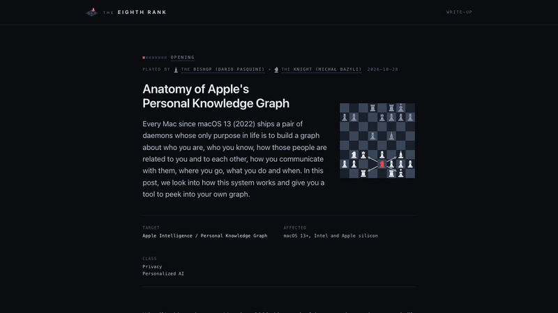

[Anatomy of Apple's Personal Knowledge Graph](https://8rank.ai/game/apple-intelligence-personal-knowledge-graph)，Eighth Rank 团队的逆向报告，HN 582 分。

结论不是"一个分类器"，而是两个随系统分发的 CoreML 模型加两个常驻守护进程：`knowledgeconstructiond` 和 `intelligenceplatformd`。它们把联系人、照片、日历、iMessage、位置、屏幕使用时间交叉比对，在本地推断你和谁是什么关系——包括"母亲""父亲""配偶"。唯一的官方文档是 man page 里一句话："analyzes the content on the device to build a general purpose knowledge graph"。2022 年起的 Mac 都带。

数据落在 `~/Library/IntelligencePlatform/`，里面是 **51 个 SQLite 数据库**，明文存储，但目录受 TCC 的完全磁盘访问保护。核心 `graph.db` 是一个三元组存储，词表 181 个实体类、278 个谓词，`PS500` = employer，`SB104` = person。模型本体叫 `EntityTagging_Family.mlmodelc` 和 `EntityTagging_FamilyAndFriends.mlmodelc`，就摆在词表旁边——**二分类 XGBoost**，输入 144 个特征。特征名以明文写在模型的 `metadata.json` 里，分三组：20 个身份特征、40 个通讯行为特征、84 个"你们共同出现的照片"特征。

这 144 个特征最能说明系统的性质。身份组有 `sameLastName`、`sharesHomeAddress`、`sharesWorkAddress`、`photosAgeDifferenceCategory`、`iCloudFamilyMember`；通讯组是 `personPopularityGivenMonday` 到 `GivenSunday`、`personPopularityGivenMorning/Afternoon/Evening/Night`、`personPopularityGivenHome/Work`——即"这个人在周几、什么时段、在家还是在公司跟你联系得多"；照片组是 84 个共同出镜特征（同行、同旅行、同节日）。换句话说，**它用"是否同姓 + 是否同住址 + 年龄差 + 工作日白天跟谁聊得多"这套行为模式来推断亲属关系。**

一个说明它还没做完的细节：模型分数不写回 `graph.db`，而是单独落到 `entityTagging.db`，每人一行、17 个关系列，**每天全量重算**。但作者只验证了其中 2 列有对应的 shipped model，其余 15 列靠什么填、概率怎么变成图里的 confidence，他们也没追出来。

从工程角度看，这不像"后门"，更像 Apple Intelligence 的产品基础设施（Personal Context 检索），推断全在端上、无服务器交互。争议点在"未文档化"和"亲属关系属于特敏感属性"：本地明文 + 单一目录，等于一个隐私单点故障——拿到全盘访问权的人（恶意软件、取证工具、备份）就拿到了一张"你全家是谁、住哪、什么时候联系"的现成关系图。作者还演示了把它喂给去对齐的大模型之后的社会工程用法。苹果 2023 年那篇关于知识图的论文（arXiv 2305.09464）里，对 kinship 推断只字未提。

对做端上 AI 的团队倒是个有价值的参考：**144 维行为特征 + XGBoost + 每日重算**，是"小模型做高价值结构化推断"的典型取舍——比上大模型便宜、可解释、可回滚。

### 795 美元的抓取机器人

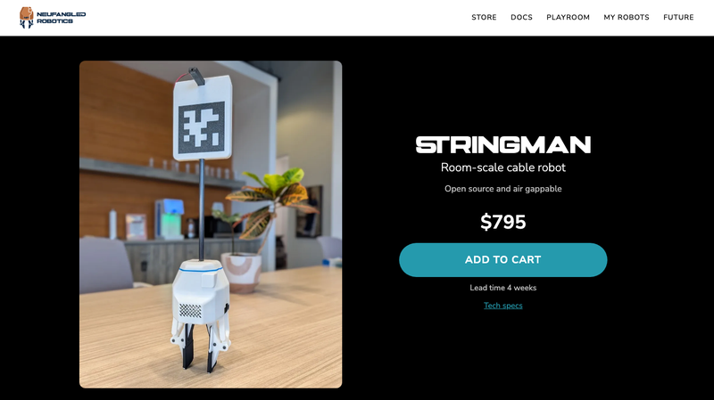

[Stringman](https://neufangled.com/)，Neufangled Robotics，HN 842 分。它不做机械臂，做的是**悬索并联机构**：四个电机装在房间四角靠天花板处，用钓鱼线把抓手吊在中间，抓手是唯一进到工作空间的部件，定位靠四根线的长度解算。

作者的核心论点是"价格 ≈ 执行器数量"。7 轴机械臂有 7 个关节，它只有 4 个电机；机械臂的工作空间是一个半球，它的是整个房间。整机售价 795 美元，BOM 合计 645.57 美元，最大的单项是 4 台 DAMIAO DM-H6215 云台电机（264 美元），其次是两台 Pi Camera Module 3、两块 Raspberry Pi 3A+、24V 电源。线材用的是 50 磅编织钓鱼线，整套 40 米 5.83 美元。抓手 638 克，两台 STS3215 舵机驱动夹爪，配薄膜压力传感器测夹持力。

自制部分只有三类：3D 打印结构件（承力件用玻纤增强 PETG）、两块 PCB HAT、控制软件。其余全是电商现货。本体不含主控——锚点各一块 Pi 3A+，抓手一块 Pi Zero 2W，控制算法跑在用户自己的电脑上。这套"把算力外包给用户"是压成本的关键。

参数：有效工作空间 XY 对角线 3 到 10 米、层高 2.3 到 4 米，标称场景 7×7×3 米共 147 立方米；负载靠近地面 2.2 公斤、全空间平均 1.9 公斤；移动速度约 0.4 米/秒；已在真实住户家中累计实测约 1000 小时。负载的物理来源值得说一句：四根线共同承担重力，所以有效负载约等于四台电机的合力上限，而不是单台额定扭矩——这是它敢用 1 N·m 级小电机的前提，代价是线张力必须留余量，28 牛是硬上限。

ASHWA 认证编号 us002788，固件 Apache-2.0，PCB 也开源，CAD 和 STL 全部公开。可以完全离线运行，提供 Python API 和 MCP server，定位是"给家里其它机器人或 agent 送料的搬运工"，兼容 LeRobot 训练栈——官方称某些 DiT 类模型 50 个 episode 就能学会一个新动作。

官网给的对比口径是：常见科研臂 0.75 米半球（0.88 立方米）卖 2500 美元，每千美元买到 0.35 立方米；Stringman 每千美元买到 185 立方米，约 500 倍。但代价也要看清：索式机构刚度低、容易摆，靠视觉加 IMU 做摆动抑制（UI 里单独有一项 "Swing cancellation"）；中间有立柱就用不了；安装要打墙或抱柱，属于"装修级"部署。HN 上第一反应也是安全——索式机构的失效模式是"掉下来"，不是"撞到"。

### 不出声，也能打字

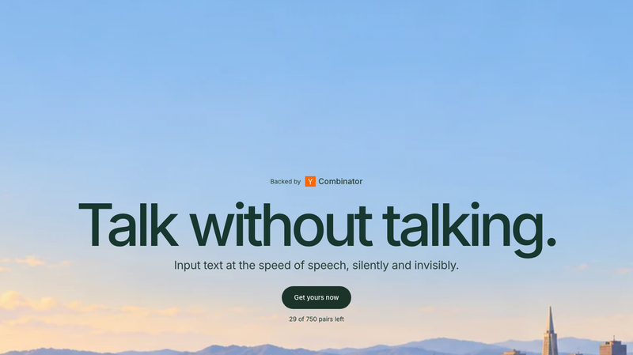

[Subvocal](https://subvocal.company/)，YC F26，Show HN 841 分。眼镜框里嵌天线，向外辐射类似蓝牙的无线电波穿过面部，经过舌头、嘴唇、软腭时被无声的发音动作调制，再用基础模型把扰动解码成文本。官网明确划了两条线：不用摄像头、不做视觉唇读；也不读"无意识的思考"，只解码你有意发出的发音动作。

这条路线的转折比产品本身更有意思。第一版是 2026 年 2 月在 Stanford TreeHacks 用 36 小时做的，目标是复刻 MIT Media Lab 的 AlterEgo，把 EMG 电极贴在脸上读肌肉电信号。结果只勉强做到字母级别，没拿奖，但让两人决定全职做。放弃 EMG 有四个理由：出汗让信号漂移、电气干扰、电极位置一变模型就废，以及最关键的——**没人愿意往脸上贴电极**。

换成射频之后，工程上的三个坎他们自己列得很清楚：极低噪声的 RF 传感链路（调制量很小，噪声底决定一切）、天线布局（要让多个天线的场最大化覆盖发音器官，第一次做在眼镜上完全失败，只能退回用胶带贴在脸上）、可重复的固定（贴胶带无法保证位置和角度一致，于是先做了个"奇怪但有效"的头戴支架，再做仿真，最后才把天线做进镜框）。

真正的难点不是"能不能测到信号"，而是跨人泛化——每个人的面部解剖结构不同，RF 信号图样差异极大。作者试过各种算法补偿，最后发现唯一的杠杆是把预训练数据规模做上去。做法很土：在办公室搭 booth，付钱请人戴着眼镜朗读提示语采数据，由此得到一条 scaling 曲线。演示视频里那个叫 Dave 的人只做了 20 句校准。官方 FAQ 对精度的表述是回避式的——说原型已能实时解码开放式无声语音，精度随数据和模型规模继续提升，任何输入法都会出错，产品靠上下文和便捷纠错兜底。**没有公开 WER，也没有公开词表大小**，因为定位是开放式听写而不是固定指令集。

标称速度 200+ WPM，预购定金 199 美元可全额退，Early Bird 总价 499 美元（原价 699），首批 500 台，预计 2027 年 Q1 发货，仅限美国。开源？不，硬件、模型、数据都没公开。

和 AlterEgo 的差别可以一句话概括：AlterEgo 证明了"不说话也能被解码"，但受限于贴脸电极的可用性；Subvocal 的赌注是把同样的信息换成非接触的射频通道，代价是要用大规模配对数据把跨人泛化硬啃下来。HN 评论区第一条质疑就打在工程要害上——为什么必须是眼镜，是不是只是为了给雷达传感器一个相对面部稳定的安装基准？答案基本是肯定的：天线位置的一致性直接决定信号可解。另有一条值得产品团队记下来：有人滚了 30 秒落地页还是没看懂这是副眼镜。

### Blender 的 C 打败了 GPUI

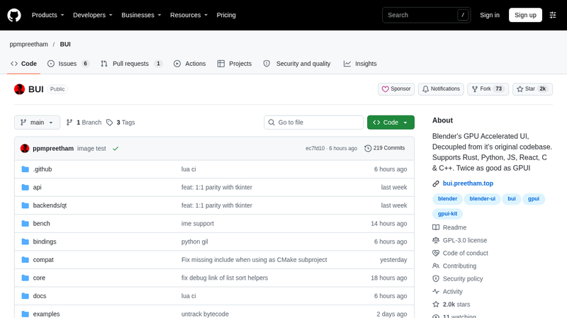

[BUI](https://github.com/ppmpreetham/BUI)，HN 717 分。标题写的是 "Blender's UI and Runtime: Much Faster Than GPUI"，但需要先纠正一点：这不是 Blender 基金会的官方结论，Blender 官方博客上没有这篇文章。它是一个第三方项目，把 Blender 的 UI 从原代码库里"解耦"出来做成独立 C 库（`kit`），窗口、控件、渲染全部复用 Blender 的 C 实现，再包一层绑定，供 Rust、Python、JS、React 和 Dear ImGui 使用。仓库 2.0k 星、219 commits、最新版 0.4.1。

数字挺刺眼。设置窗口的首帧：blenderui 40 ms，gpui 231 ms，gpui-fast 226 ms；启动到可交互的 CPU 时间 27 ms 对 226 毫秒；常驻内存 15 MB 对 29 MB。稳态帧率测试用 3000 个带动画的单元格：blenderui 的 GPU 渲染跑到 59.9 fps，CPU 光栅 57.6 fps，而 gpui-fast 只有 31.5 fps、gpui 19.9 fps——换算成 CPU 每帧耗时是 11.6 ms 对 31.9 ms 对 50.5 ms。520×900 窗口整屏重绘约 0.7 ms，只重绘脏矩形约 0.05 ms，输入到上屏 0.06 ms。

快的原因不是玄学：渲染器是单个 shader 加实例化，后端只有 D3D11 和 GL 3.3 两条；字形与图标进图集；持久化 render target 加 damage rect，只提交脏区域；flip-model swapchain 避免每帧重建。对照组 GPUI 走的是 Rust 过程式布局加每帧重建 scene graph。为了证明不是靠偷画，作者跟 Blender 原生软件光栅器做了像素级对比：172,800 个像素里只有 10 个差值超过 3/255。

但评论区那条反驳同样有效：两者并不同代。gpui 的实现里**没有任何表单控件**（用样式化的 div 拼输入框），而 blenderui 是一套完整 widget 集；gpui-fast 的帧率在 30 到 60 fps 之间波动；测量早于后续功能加入；BUI 目前也没有无障碍层和 IME 支持——而 Blender 本体的 CJK 输入一直是老大难。

所以正确的结论不是 "C 打败 Rust"，而是：**一套为立即模式绘制优化的 C widget 栈，比一套为编辑器场景设计的 retained/Rust 框架，在密集控件场景下开销低一个量级。** 真正值得记住的是这个反直觉之处——GPU 加速的现代 UI 框架并没有自动赢得性能，它在"每帧重建场景 + 通用布局"上付出了成本。至于这个成本值不值，取决于你更在乎启动那 200 毫秒，还是无障碍和输入法。

### 用刻录机在光盘上作画

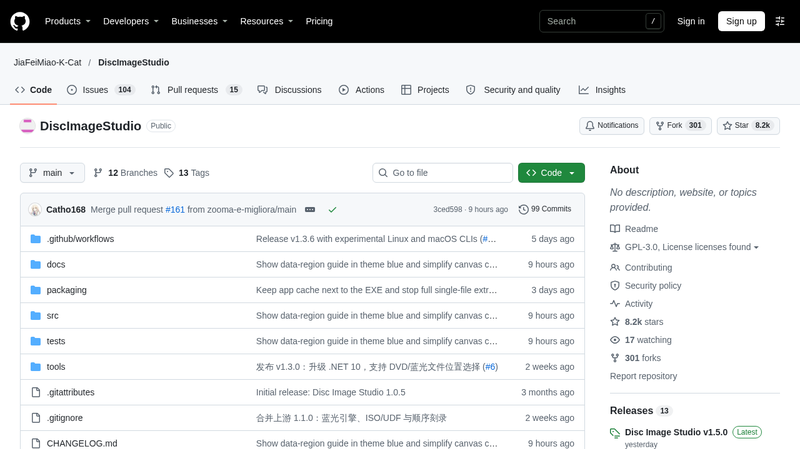

[DiscImageStudio](https://github.com/JiaFeiMiao-K-Cat/DiscImageStudio)，8.2k 星。刻盘就是用激光在记录层烧出不可逆的坑，坑与未烧区的反射率不同，肉眼在盘面上就看得见明暗——所以理论上可以"画图"。这个项目把图片编码成一串合法的扇区数据，让激光按图去烧，刻完拿起来一看，盘面上就是那张图。

听起来简单，实际处处受物理层约束。灰度只有两级，CD 和 DVD 都是黑/白，CD 用 `0D`/`AA` 两个字节模式，DVD 在 scramble 域里用 `A5`/`92`。分辨率不是靠灰阶堆出来的，而是靠每个扇区一小块可分辨的坑面积，所以成品是网点式的。工程上真正的瓶颈是径向 track pitch 与切向坑长的机械精度，项目为此内置了"拍照标定"：用手机拍一张已刻好的盘，反推内圈外圈半径和 track pitch，再对 pitch 做三次拟合。

最容易被忽略的一条限制是：**盘上必须真的写入了数据**。只有落在数据区内的像素才会被烧出来，纯绘图模式也要生成合法扇区（含同步头、ECC、scramble），否则刻录机拒写。软件用 Windows IMAPI2，拒绝非空白盘，不能续刻覆盖。v1.5.0 支持任意 CD（音频 CD 用 WAV+CUE 或 RAW bin）、任意 DVD、单层 BD-R 25GB，双层盘不支持。

技术栈很朴素：C# 98.2%，.NET 10，GPL-3.0，要求 Windows 10 2004 及以上。v1.5.0 刚加了实验性的 Linux/macOS CLI，但实际刻录仍要依赖 Windows 的 IMAPI2 或外部刻录软件。

这个项目好在它把"约束即创意"演示得很彻底——所有美感都来自物理层的限制：两级灰度、扇区对齐、必须合法 ECC。它画的不是图，是扇区。真实用途也实在：给自制音乐 CD 和纪念光盘做盘面，做物理层研究的教学样本（ECC、scramble、track pitch 一次讲清），以及最实际的——验证一张盘是不是真的被烧过、烧在哪个区域。它不是 LightScribe（那需要专用涂层盘和专用刻录机），而是拿普通刻录盘做"数据即像素"。

### 把中国历史装进一条时间轴

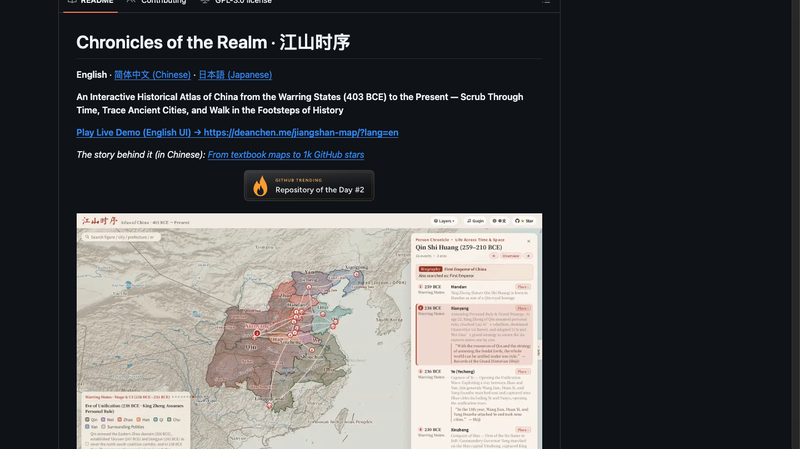

[江山时序](https://deanchen.me/jiangshan-map/)，GitHub 4,558 星，GPL-3.0。中国历史地图时间轴，从战国（前 403 年）一路到现代，18 个朝代、164 个疆域快照，时间轴每秒推进一年。

图层分两半。历史舆图要素：历史疆域、州道政区、古地名、关河丝路、重大事件。山川与现代参照：山川水系、现代省界、现代省名。后一半是关键——古代地名和行政区划对现代人几乎没有空间概念，叠上今天的省界和山脉，"魏国在河南哪里"才变得可回答。点任何一个地点，会给出古今政区沿革的溯源。

项目还有两个不太像"地图"的设计。一个是"舆图寻址"答题模式：给你一个年份和地名，让你在地图上点出来，共 10 题、实时计分。另一个是雅乐——背景音乐配的是古曲，配合繁简英日多语言切换，整体是想做成教材的替代品，而不是 GIS 工具。作者写过一篇创作手记叫《从课本插图到开源历史地图》，说的就是这个动机：历史课本上的地图是静态的、割裂的，学生记不住疆域是怎么变的。

技术构成上 HTML 占 48.5%、JavaScript 47.8%，基本是前端渲染为主，没有后端。仓库 7 月 23 日才创建，到 11 月已经 4,558 星，GitHub Trending 上拿过 Repository of the Day 第二名，今天还有提交。

从工程角度看，这类项目的难点从来不是"画地图"——是数据。164 个疆域快照背后是历代地理志、历史地图集的数字化工作，以及"同一个地方在不同朝代叫什么"的对照表。这种活儿没法靠算法加速，只能一条条考据。所以它的护城河不是代码，是那份把两千年政区沿革整理成结构化数据的工作量。这也是为什么它值得被当成教材的替代品：一个愿意为地名考据花几百小时的人，和一个愿意为动画流畅度花几小时的人，做出来的东西不在一个量级。

### 33 个协议的动画课

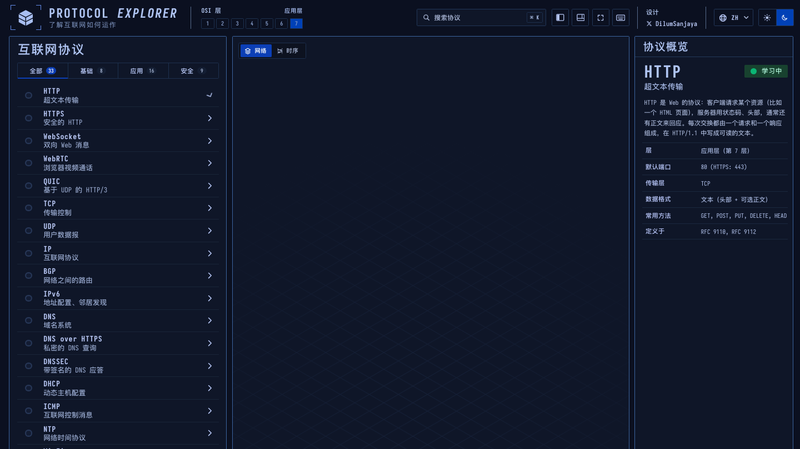

[Protocol Explorer](https://protocol-explorer-alpha.vercel.app)，作者 Dilum Sanjaya。把 33 个互联网协议拆成分步动画，让数据包在屏幕上真的从源走到目的地。

协议分三组：核心 8 个、应用 16 个、安全 9 个。HTTP 拆成 5 步——客户端准备请求、DNS 解析服务器 IP、建立 TCP 连接、HTTP 请求响应、浏览器渲染；HTTPS 是 6 步，多一个 TLS 握手，并且明确指出 DNS 查询这一步**是不加密的**。左侧列表从上到下就是 OSI 分层的一次完整巡礼：HTTP、WebSocket、WebRTC、QUIC 在应用层，TCP、UDP、IP、BGP、IPv6 在传输和网络层，再往下是 DNS、DHCP、ICMP、NTP 这些"知道名字但说不清在干什么"的，最后是 WPA2/WPA3、RADIUS、Captive Portal、SSH、TLS、WireGuard、IPsec 这些安全侧的。

右栏的协议概览是给工程师用的：层号、默认端口、传输层、数据格式、常用方法、定义于哪个 RFC。HTTP 那条写的是 RFC 9110 和 RFC 9112——不是坊间常引的 2616。底部"数据包流"面板列出每个包的时间、源地址、目的地址、协议、信息、大小，可以播放、单步、重置。这个设计比纯动画好：动画讲原理，包流给你可核对的细节。

界面上有学习进度追踪（33 个里完成了几个）、20 种语言（含简繁中文）、OSI 七层指示器。作者的定位显然是"教学工具"而不是文档站——文档告诉你协议是什么，动画告诉你它怎么发生过。

这类工具的真正的价值在于补上一个教育断层：计算机网络课上的文字和图片能讲清楚"三次握手"的定义，但讲不清楚"你的一个回车，最后是怎么变成屏幕上的一个标题的"。可视化能补上这条因果链，而且成本极低——33 个协议，一个人写完，放在 Vercel 上免费跑。它现在还是 alpha，标记着 "designed by" 一个人的名字，但它已经比大多数教材的配套资源做得完整。

### HN 推荐的 24 小时电视台

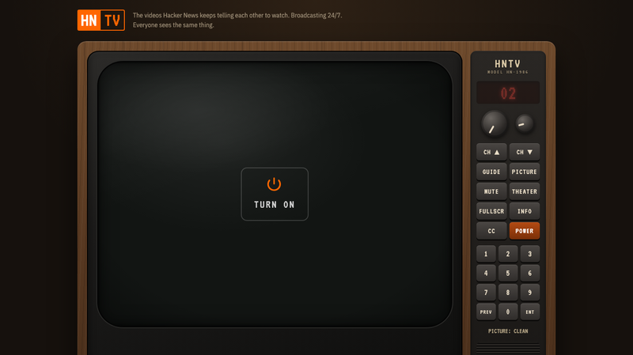

[HackerTV](https://hackertv.org)，作者 Danny Salzman，Show HN 488 分。把 Hacker News 上被反复推荐的那些 YouTube 视频做成 7×24 小时连续播放的电视频道，界面是一台 1986 年款式的木壳 CRT 电视。

首页那句话说得很准："The videos Hacker News keeps telling each other to watch. Broadcasting 24/7. Everyone sees the same thing."——重点在最后半句。不是点播库，是同步播出，所有人同一时刻看到同一帧。这是把"流"这个已经被点播消灭了的概念重新捡回来，代价是内容不受你控制，好处是有了共同经验和"现在正好在放什么"的巧合。

内容链条挺有讲究：目录种子来自 HackerTube（ODC-BY 授权），建在 open-index/hacker-news 归档上，每周从新的 HN 评论里通过 HN Search API 更新，代码过滤加模型打标签。频道不止一个，02 台叫 HN PRIME，放的是"全时段最被推荐"的视频，还有按主题分的台。界面细节做到位了——遥控上有频道上下、GUIIDE、PICTURE、MUTE、THEATER、FULLSCR、INFO、CC、POWER，0-9 直接换台，键盘方向键和字母键对应同一套功能，双击屏幕全屏。甚至"PICTURE: CLEAN"这种老电视的调谐提示都复刻了。

一个诚实的细节：页面自己写着"时长的估算在拿到 YouTube 元数据之前是估的，所以有些节目会提前结束（显示 please stand by）或者被切断"。也就是说它承认自己的节目单是不精确的——这反而符合电视的体验，你不会真的知道下一个节目的第几分钟会发生什么。

这条和上个月的 HackerTube、HackerBooks 其实是同一个运动的三个切面：把 HN 这个"高质量信息池"重新编排成一种可消费的形态——视频站、书单、电视台。共同点在都不生产内容，只做筛选和呈现，而筛选的依据是"被不同的人反复推荐过"。在推荐算法把每个人推进各自信息茧房的时代，这种"用社群共识而不是个人画像做推荐"的做法，反而成了一个稀缺品。

### 画图程序也能被利用

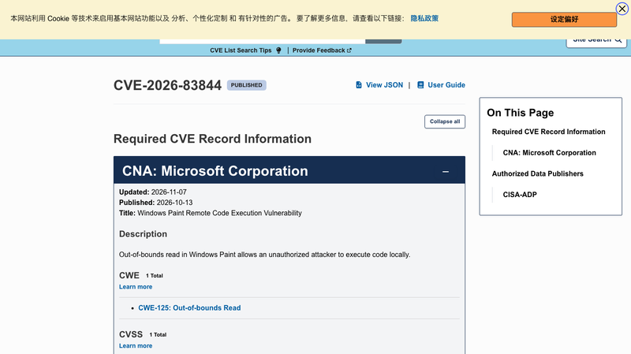

CVE-2026-83844，标题是 "Windows Paint Remote Code Execution Vulnerability"，CVSS 3.1 打了 7.0 分。HN 上 716 分、281 条评论，热度主要来自标题里的对比——画图，那个用来涂色的小程序。

但把细节读进去，它没有名字听起来那么可怕。漏洞类型是 CWE-125 越界读，微软的官方描述只有一句话："Out-of-bounds read in Windows Paint allows an unauthorized attacker to execute code locally."攻击向量是 AV:L——本地，不是"发张图就能远程打"。利用条件 AC:H（需要内存布局配合），需要用户交互 UI:R（自己打开文件），机密性、完整性、可用性三项都算 High。

受影响版本是 Microsoft Paint `11.0.0.0` 到 `11.2609.401.0` 之前，修复在上界那个版本。需要注意这是 Store 版 Paint 的版本号（11.x 系列），不是 Windows 内部版本号——意味着补丁走 Microsoft Store 应用更新，而不是每月的 Patch Tuesday 累积更新。旧版 `mspaint.exe`（6.1 或 10.0 版）不在这个 CVE 范围内。

值得说清的是"越界读怎么变成代码执行"。越界读本身通常只造成崩溃或信息泄露，能升级成任意代码执行，说明读到的是可用于绕过缓解措施的内存内容——具体读到什么、怎么用，微软没公开。公开信息也就到"Paint 的越界读"这一层，任何指着"某个编解码器"的说法目前都是推测。

真正的启示不在漏洞本身，在攻防的认知偏差上：企业环境里 MS Paint 长期被当成"无害附件"，这个假设被打破了。但它的实际优先级应该低于同期那些网络向量的漏洞——AC:H 加 UI:R 的组合意味着攻击者得先让你打开一个特制图片，还得赌上内存布局。倒是"补丁走 Store 不走系统更新"这件事值得运维记一下：很多人以为打了 Windows 更新就完事了。

### 在看不见的屏幕里跑 Agent

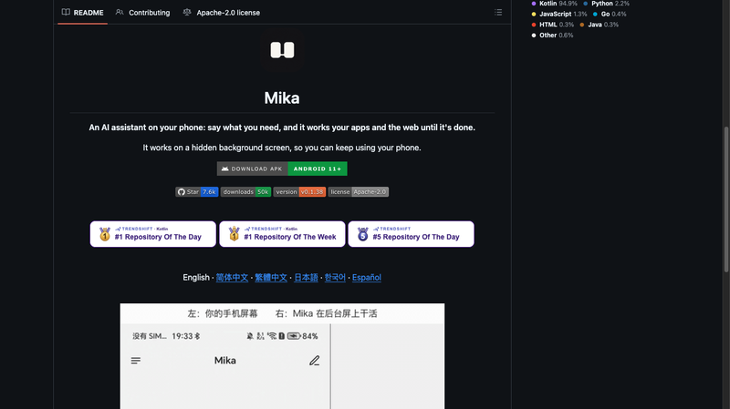

[Mika](https://github.com/wangzan101/Mika)，7.6k 星、GitHub Trending 当日和当周双料第一，Kotlin 占 94.9%，Apache-2.0，Android 11 起步。一句话说清它的定位：「你说话，它在你手机上操作 App 和网页，直到做完为止。」

最有意思的设计是那句"It works on a hidden background screen, so you can keep using your phone"——它在另一块屏幕上开 App、点按、打字、滚动，你继续用你自己的屏，想看的时候点一下小窗口瞄一眼。这解决了 agent 落地最实际的一个摩擦：没人愿意在手机被接管的那几分钟里盯着进度条。首页那张对比图直接把这个说清了：左边是你的手机屏幕，右边是 Mika 在后台屏上干活，两边同时进行。

它怎么"看"屏幕值得单独说。README 写的是 "Looks at the screen and finds buttons the way a person does: no app APIs, no per-app integration"——不接任何 app 的接口，靠识别屏幕元素来定位按钮。要操作手机 App 时，得在设置里走一遍"设置手机控制"向导、配对一次无线调试（ADB 只在这一步用到，不是每次操作都走外部命令），跳过这步也能用聊天、网页和文件功能。

架构上有几个不像"手机 App"的选择。它没有服务器——模型用你自己的 API key，或者直接登录 ChatGPT、xAI、OpenRouter 账号，数据不出你的手机。每段对话配一个 Linux 沙箱，能在你发过去的文件上跑 Python、Node 和 shell（arm64）。还提供 CLI + Skill 和 MCP，也就是说电脑上的 AI 工具可以把任务递给手机上的 Mika 去跑。另外它会记住你说过的偏好，把完成过的任务沉淀成 skill——下次同类任务更快更稳。

默认是 Ask 模式：只在要花钱的时候（下单、支付）先问你，其余动作直接做。这个默认值挺关键——它承认了"逐步确认"会让 agent 变得没用，于是把确认的门槛精确地卡在金钱那一条线上。其他细节也都对着真实使用场景：内置浏览器保持登录态、能读页面、能下载上传；浮窗胶囊双击就把当前屏幕发过去问"这该怎么回"；长按说话、松手发送；登录、验证码、付款这类事一律交回给人。

README 里的演示清单很能说明它的目标用户：总结群聊今天聊了啥、在小红书读完某博主的逐条帖子再总结、在招聘网站上给 3 个岗位打招呼投递、找旧金山到纽约最便宜的红眼直飞、念出新闻站前五条、看广告解锁音乐会员、叠券点外卖并在付款前停下来问一句。前几条都指向国内常用的 App，但作者强调它不绑定任何具体应用。

从趋势上看，这类项目代表一种正在成形的架构共识：**Agent 需要一个不跟用户抢资源的执行环境。**云端跑浏览器是一种做法，本地开出一块虚拟屏是另一种，共同点是"把 agent 的操作空间和人的操作空间隔开"。真正的门槛其实不在虚拟屏技术——Android 早就有 VirtualDisplay——而在于"看屏幕找按钮"这条路线的稳定性：它绕开了 app 接口，也就绕开了所有反爬和 API 限流，但同时继承了人类界面的所有脆弱性（改版、弹窗、加载慢）。Mika 那 75 个 open issue 大概能告诉你这条路有多不平。

## 订阅
这里会不定期分享我看到的有趣的内容（不一定是最新的，但是有意思），因为大部分都与机器有关，所以先叫它"机器文摘"吧。

Github仓库地址：https://github.com/sbabybird/MachineDigest

喜欢的朋友可以订阅关注：

- 通过微信公众号"从容地狂奔"订阅。


